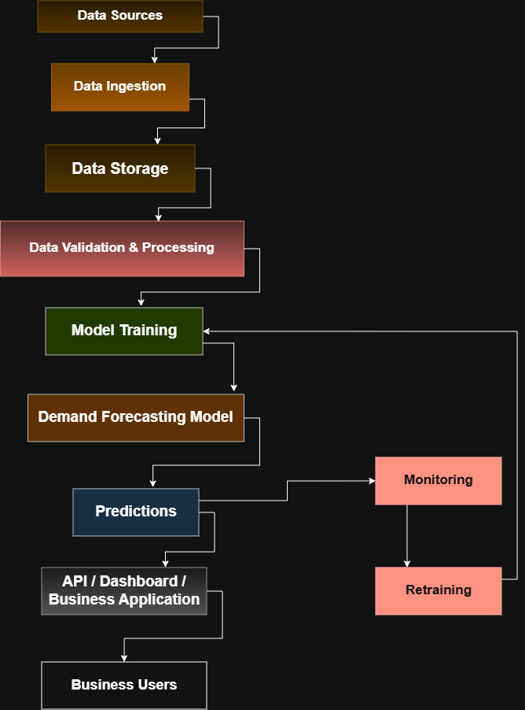

# Retail Demand Forecasting Platform

## Project Overview

The Retail Demand Forecasting Platform is a production-oriented AI and machine learning project designed to help a retail business predict future product demand across multiple stores.

Retail businesses can face two common inventory problems:

- Overstocking, where too much inventory is purchased or stored
- Stockouts, where products become unavailable when customers want to buy them

The goal of this project is to build a system that can use historical business data to estimate future demand and support better inventory, purchasing, and stocking decisions.

This project is being developed gradually through structured engineering sprints.

## Business Problem

The retail company operates multiple stores and sells many products.

Management needs better visibility into future demand so that inventory and supply chain teams can make more informed decisions about:

- How much stock to order
- Which products need replenishment
- Which stores may require additional stock
- Which products may be at risk of stockout
- Which products may be overstocked

The forecasting system is intended to support these decisions by providing future demand estimates.

## Development Progress

This project is being developed step by step through structured engineering sprints.

### Sprint 001 — Business Understanding and System Design ✅

Sprint 001 focused on understanding the business problem and planning the initial direction of the project.

Completed work included:

- business problem understanding
- client discovery questions
- initial data requirements
- data quality considerations
- high-level system architecture
- initial GitHub repository structure
- initial development plan

The Sprint 001 work is kept in the `docs/` folder and forms the foundation for the later development stages.

### Sprint 002 — Data Understanding, Cleaning and Validation ✅

Sprint 002 moved the project from planning into the first working data engineering stage.

Completed work included:

- exploration of the raw retail sales dataset
- identification of data-quality issues
- reusable data cleaning functions
- reusable data validation checks
- cleaned and rejected datasets
- automated pipeline tests
- data-understanding notebook
- data dictionary
- data quality report
- Sprint 002 handover documentation
- Git feature branch and Pull Request workflow

### Sprint 002 Results

The raw dataset contained **26,230 rows**.

After cleaning:

- **26,105 rows** remained in the cleaned dataset
- **125 rows** were preserved in the rejected dataset
- **5 automated tests** are passing

The project now has a clean and validated data foundation that can be used for the next stages of demand analysis, feature engineering, and forecasting.

## Assumptions

At this stage, the following assumptions are being made:

- Historical sales data will be available
- Product and store information will be available
- Dates and transaction history will be available
- The company wants to reduce both stockouts and overstocking
- Forecasts may eventually be required at product and store level
- The final forecast frequency may be daily, weekly, or monthly
- Data quality issues may need to be handled before model development
- The final solution may eventually be accessed through an API, dashboard, or business application

These assumptions will need to be confirmed with the client.

## Proposed Technology Stack

The following technologies are currently being considered for the project:

- **Python** - main programming language for data processing and machine learning
- **Pandas** - working with and analysing tabular data
- **Scikit-learn / forecasting libraries** - initial model development and evaluation
- **FastAPI** - possible API layer for exposing predictions to other applications
- **Git** - version control for tracking project changes
- **GitHub** - repository hosting, documentation, and project collaboration
- **draw.io / diagrams.net** - architecture and system diagrams

The technology stack may change after the client's technical environment and deployment requirements are confirmed.

## High-Level Architecture

The proposed high-level architecture shows the expected journey of data through the forecasting platform:

1. Data sources
2. Data ingestion
3. Data storage
4. Data validation and processing
5. Model training
6. Demand forecasting model
7. Predictions
8. API, dashboard, or business application
9. Business users
10. Monitoring and retraining



## Repository Structure

```text
retail-demand-forecasting-platform/
│
├── data/
│   ├── raw/
│   │   └── Sprint_002_Retail_Sales_Data.csv
│   │
│   ├── processed/
│   │   └── retail_sales_cleaned.csv
│   │
│   └── rejected/
│       └── retail_sales_rejected.csv
│
├── docs/
│   ├── architecture.png
│   ├── client-questions.md
│   ├── data-dictionary.md
│   ├── data-quality-report.md
│   ├── data-requirements.md
│   ├── problem-understanding.md
│   ├── sprint-002-handover.md
│   └── week-1-plan.md
│
├── notebooks/
│   └── 01_data_understanding.ipynb
│
├── src/
│   └── data/
│       ├── clean.py
│       ├── load.py
│       └── validate.py
│
├── tests/
│   └── test_data_pipeline.py
│
├── .gitignore
├── README.md
└── requirements.txt
```

The Sprint 001 files are still retained in `docs/`, including the architecture, business understanding, client questions, data requirements, and initial plan.

Sprint 002 adds the working data pipeline, notebook, tests, cleaned outputs, rejected outputs, and supporting documentation.
## How to Run the Sprint 002 Data Pipeline

From the project root folder, run:

```bash
python src/data/load.py
```

This will:

- load the raw retail dataset
- apply the cleaning rules
- save the cleaned dataset
- save the rejected dataset
- print a short summary in the terminal

Expected result:

```text
Raw rows: 26230
Cleaned rows: 26105
Rejected rows: 125
```

## Run the Automated Tests

To check that the pipeline is working correctly, run:

```bash
python -m pytest -q
```

Expected result:

```text
5 passed
```
## Sprint 002 Documentation

The main Sprint 002 documentation is available here:

- [Data Understanding Notebook](notebooks/01_data_understanding.ipynb)  
  Shows the raw-data exploration, data-quality checks, cleaning decisions, and final validation.

- [Data Dictionary](docs/data-dictionary.md)  
  Explains each dataset column, its expected type, and the cleaning rules applied.

- [Data Quality Report](docs/data-quality-report.md)  
  Summarizes the data-quality issues found in the raw dataset and how each issue was handled.

- [Sprint 002 Handover](docs/sprint-002-handover.md)  
  Summarizes the completed pipeline, final results, important files, and how to run the project.

  ## Next Steps

Sprint 001 and Sprint 002 are complete.

The project now has:

- a clear business problem and system architecture
- documented data requirements
- a validated raw dataset
- a reusable cleaning pipeline
- cleaned and rejected datasets
- automated tests
- supporting technical documentation

The next stage will focus on building the forecasting foundation.

Planned Sprint 003 work includes:

- deeper exploratory data analysis
- sales trend analysis
- seasonality analysis
- store-level demand analysis
- product-level demand analysis
- time-based feature engineering
- preparation of forecasting-ready datasets
- creation of a simple baseline forecasting model
- evaluation of baseline model performance

Later sprints will build on this foundation with improved forecasting models, prediction pipelines, APIs or dashboards, monitoring, and deployment.
